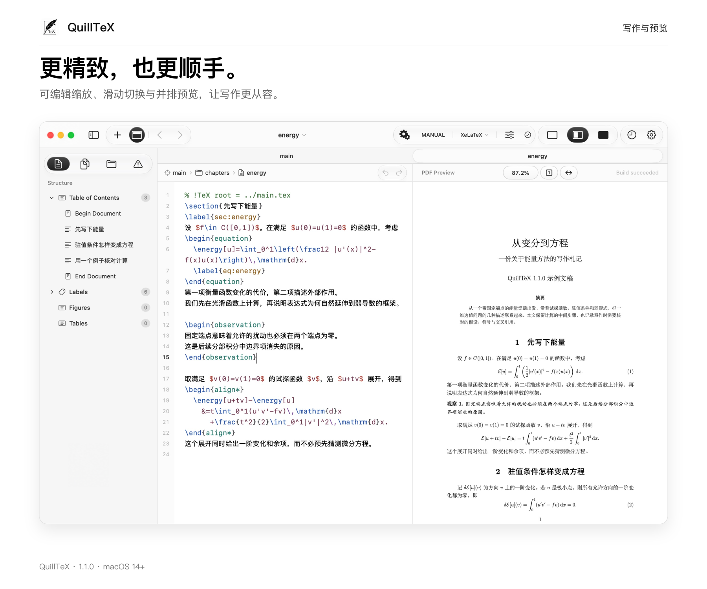

# QuillTeX 1.1.0

1.1.0 重新梳理写作时最常用的交互：随输入更新的行内补全、清晰的编译结果，以及统一的胶囊按钮与弹窗。

- 新开或切换文件时自动显示标签栏；主文件固定在首位，其余标签可拖动排序并恢复顺序。
- Folder 根目录靠左并始终展开，子目录可折叠；直接在当前展开的文件夹里新建 TeX 或文件夹；未展开子目录时建在根目录。新建先显示默认名称占位，重命名直接在原行编辑；回车或点击侧栏空白处保存，留空沿用默认名。右键菜单采用紧凑、对齐的应用弹窗样式，可新增子文件、重命名或移到废纸篓。
- 打开工程时，为缺少主文件注释的 TeX 文件补充首行注释；主文件固定为打开工程时确定的文件，重命名时相关注释自动更新。
- Subfiles 仅显示不含后缀的文件名，悬停可查看相对路径；按主文稿的引用顺序排列，未引用文件独立列在下方；两组均可折叠，中间以留白分隔，仅在拖动时临时增加少量上下间距，并用细线标出落点。拖动可在某个引用之前或之后插入，两种位置分别指向对应的源码行；也可直接拖到主文稿某行插入，已有引用可拖动调整位置。
- PDF 顶栏提供 Actual Size（100%）、适应宽度与可编辑的缩放胶囊；三项控件统一使用清晰描边的胶囊样式，输入百分比后按回车或移开焦点即可应用，菜单和手势缩放同步更新数值。
- 模板导入后保留在模板库，并恢复曾被误移出的本地模板。
- 打开的 TeX 与 PDF 随外部保存更新；TeX 存在未保存编辑时，提示选择保留当前编辑或使用外部版本。
- 补全直接显示在光标后，随输入字母更新，优先匹配工程自定义命令与环境；不再显示候选列表。
- 完整预览参数与右括号，按 Tab 接受；自动配对括号，复用已有参数，并在上文未闭合的 `begin` 后补全对应的 `end`。
- 数学公式中的行内提示可在配对的 `$`、括号及已有公式内容前显示，按 Tab 接受时保留后文。
- Result 将警告和错误分成可折叠列表，标题、问题数量与说明层级清晰；移除分类筛选、面板内的前后跳转和 Raw Log。
- 玻璃质感的胶囊分组搭配持续可见的滑动选中态，切换分栏时选中块在三个位置之间平滑移动；顶栏与侧栏使用一致的过渡，悬停时轻微上浮并显示短线，按下时轻微回弹。
- 统一文件信息、文件选择、历史记录和编译相关弹窗的配色与留白，编译引擎选择使用更紧凑的弹窗。编译引擎及模式使用居中的分段胶囊，策略列表平滑向下展开收起，说明位于策略按钮下方居中显示。

## 新版演示

[从变分到方程 · PDF](demo/main.pdf) · [主文稿源码](demo/main.tex)

这份新写的多文件数学札记使用 `energy` 命令与 `observation` 环境。打开主文稿后，可在子文件中输入 `\begin{ob` 体验自定义环境的行内补全，再编译并查看 Result，或在编译设置中切换引擎与策略。在文稿副本中加入暂未定义的引用，可体验警告分组与源码定位。

